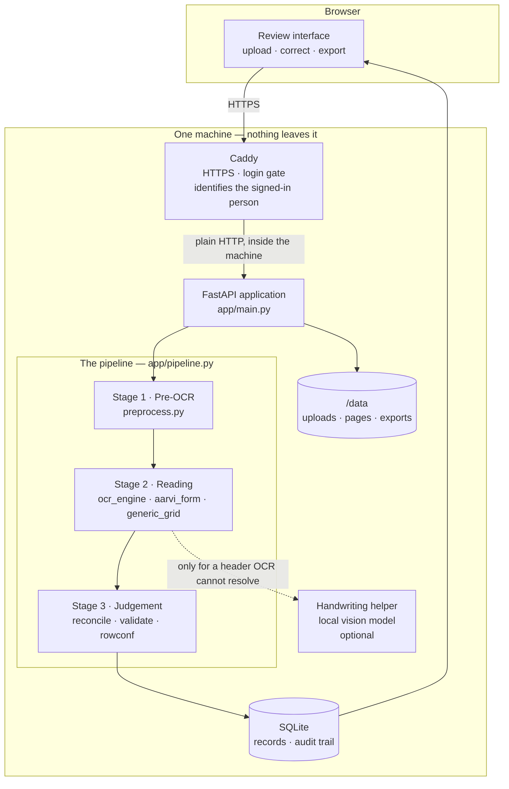
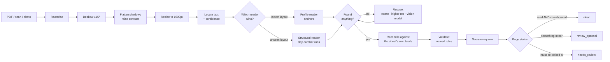
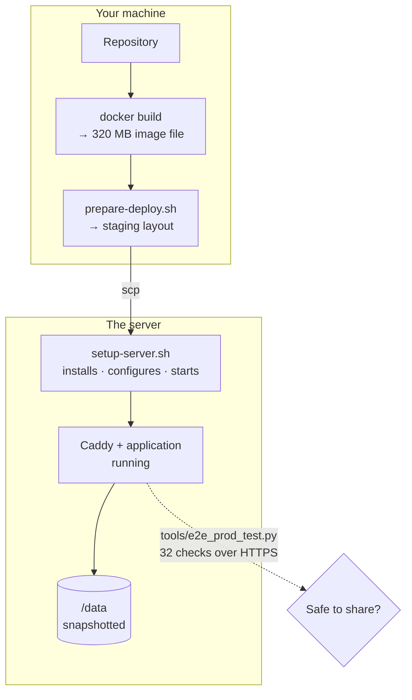

# Architecture

What this system is, how it is put together, and why each piece was chosen.

Written to be read start to finish. Every technical requirement comes with the
reason for it, because a requirement without a reason is impossible to
challenge later — and some of these should be challenged as circumstances
change.

---

## 1. The use case this was built for

AARVI ENCON supplies manpower to industrial sites: refineries, power plants,
construction projects. Each site keeps a monthly attendance sheet for the
workers posted there. At month end those sheets come back to the office so
workers can be paid and clients invoiced.

Four facts about those sheets drove every decision that follows.

**They are filled in by hand.** A site supervisor ticks boxes and writes times
with a pen. Handwriting varies enormously, and some entries are faint pencil.

**Every client site uses a different form.** A Technip sheet looks nothing like
an ISGEC sheet. Column orders differ, labels differ, some have clock times and
some do not. One sheet holds one worker; another holds thirty-three.

**They arrive as scans and photographs.** Some are clean PDF scans. Many are
phone photos: tilted, shadowed, occasionally upside down.

**The volume is real but not enormous.** 3,733 documents across three regional
offices for one financial year — roughly 3,000 pages in a busy month.

And one fact about the data, which turned out to be the most constraining of
all: **the sheets name real workers and record exactly which days each of them
worked.** That is personal data belonging to AARVI and its clients' employees.

### What the system therefore has to be

| Requirement | Because |
|---|---|
| Reads handwriting, not just print | The sheets are handwritten |
| Tolerates dozens of unknown layouts | Every site uses its own form |
| Survives tilted, shadowed, rotated photos | That is how they arrive |
| Says when it is unsure | A wrong attendance mark pays a worker for a day they did not work, and nothing downstream looks wrong |
| Runs where the data already is | The documents are personal data; sending them to a third party changes the legal and commercial position |
| Costs little to run | A manpower vendor's back office, not a technology company |

That fifth row is the one that shaped the architecture more than anything else.

---

## 2. The shape of it



Two containers and a folder on disk. No managed database, no object storage,
no message queue, no load balancer, no external API call anywhere in the
reading path.

That minimalism is deliberate, and §6 explains what it buys.

---

## 2a. Service inventory

Everything that runs, with its port, dependencies, configuration and how to
check it. Taken from `source-code/deploy/docker-compose.yml` and
`deployment/docker-compose.prod.yml`.

| | `timesheet` | `caddy` | `ollama` |
|---|---|---|---|
| **Container name** | `timesheet-app` | `timesheet-caddy` | — runs on the host, not in a container |
| **Image / source** | `timesheet-app:2.0.0` (built from `source-code/Dockerfile`) | `caddy:2` (official) | installed via `ollama.com/install.sh` |
| **Port** | `8077` | `80`, `443` | `11434` |
| **Reachable from** | **Inside the machine only.** In production `ports` is reset to empty and only `expose` is set | **The internet.** The only public door | **`127.0.0.1` only** |
| **Purpose** | The application: upload, pipeline, review API, Excel export | HTTPS certificate, login gate, and setting the signed-in person's identity | Reads handwritten headers the OCR cannot resolve |
| **Depends on** | nothing | `timesheet` (`depends_on`) | nothing |
| **Configuration** | `config.env` (behaviour), `overlay/app/*.py` (13 bind-mounted files) | `gcp/Caddyfile`, `gcp/users.caddy` (logins), `.env` (`SITE`) | `/etc/systemd/system/ollama.service.d/override.conf` |
| **Persistent data** | `./data` → `/data` | `caddy_data`, `caddy_config` (named volumes, hold the certificate) | the downloaded model |
| **Restart policy** | `unless-stopped` | `unless-stopped` | `systemd`, enabled |
| **Health check** | built in: `curl /api/health` every 30s, 5s timeout, 40s grace, 3 retries | `docker compose ps` | `curl -sf http://127.0.0.1:11434/api/tags` |
| **Optional?** | No | No — without it there is no HTTPS and no login | **Yes.** Set `TS_VLM_HEADER=0`. Costs ~2 points on handwritten names |

### How they talk to each other

```
internet ──443──> caddy ──8077──> timesheet ──11434──> ollama
                                       │                (host-gateway)
                                       └──> /data  (database, uploads, exports)
```

Caddy reaches the application over the private Docker network, never over a
published port. The application reaches Ollama on the host via
`host.docker.internal`, which is mapped with
`extra_hosts: host.docker.internal:host-gateway` so it works on Linux as well
as on Docker Desktop.

### Starting them

One command brings up both containers, with the base file supplying the
application and the production file layering Caddy in front of it:

```bash
docker compose -f docker-compose.yml -f gcp/docker-compose.prod.yml \
  --env-file config.env --env-file .env up -d
```

Both env files are required. `config.env` holds behaviour; `.env` holds the
site name used for the certificate.

### Identity, and why the header is *set* not appended

Caddy authenticates, then passes the signed-in username to the application:

```
header_up X-Remote-User {http.auth.user.id}
```

`header_up` **sets** the header, replacing anything the browser sent. If it
appended instead, a browser could supply its own `X-Remote-User` and every
entry in the audit trail would be forgeable.

### Resource shape

| | |
|---|---|
| OCR workers | `TS_WORKERS=2` — two pages read in parallel |
| OCR threads per worker | `TS_OCR_THREADS=2` |
| Memory, application | ~2–3 GB under load |
| Memory, Ollama with the model resident | ~4 GB (`OLLAMA_KEEP_ALIVE=2h` keeps it warm) |
| Upload limit | 512 MB per request, set in the Caddyfile |

There are no CPU or memory limits set in the compose files. On a dedicated
machine that is intentional — the pipeline should use what is available. If you
co-host anything else, add `deploy.resources.limits`.

---

## 3. The pipeline, stage by stage



### Stage 1 — make the page readable

`app/preprocess.py`. A PDF or photograph becomes exactly one normalised PNG
per page.

| Step | Reason |
|---|---|
| Rasterise with `pypdfium2` | Needs no external binary, so the container stays self-contained |
| Deskew, but only within ±15° | A wider search starts "correcting" pages that were never crooked. Pages rotated a full 90° or 180° are handled later by a different mechanism, because they are a different problem |
| Flatten shadow gradients, then CLAHE | Phone photos have uneven lighting; faint pencil disappears without local contrast enhancement |
| Resize to a long edge of 1,600px | See the note below — this number has a history |

**On that resolution.** Raising it to 2,400 appeared to improve handwriting
accuracy from 83.6% to 87.1%. It did not. It was compensating for a defect
elsewhere — the OCR angle classifier, §3.2. Once that was fixed, 1,600 scored
*better* than 2,400 and ran faster. An improvement that is really a workaround
for an unfound bug will mislead you about everything downstream.

### Stage 2 — read text, then structure

`app/ocr_engine.py` locates every piece of text with its position and a
confidence score. **Everything downstream works from that list of positioned
text, never from the image again.**

**One setting matters more than anything else in the system:**

```python
OCR_USE_CLS = os.getenv("TS_OCR_USE_CLS", "0") == "1"   # default OFF
```

The OCR engine ships an "angle classifier" that decides whether each text box
is upside down. On short numeric cells — which is what a timesheet is mostly
made of — it guesses wrong often. It was turning `09:00` into `00:60`.
Switching it off moved clock-time accuracy from **83.6% to 93.8%**: a one-line
change worth more than ten points, and the single largest win in the project.
It is pinned by the regression guard for that reason.

Then two readers compete:

**The profile reader** (`app/aarvi_form.py` with `app/form_profiles.py`) works
by *anchors*. It looks for printed labels — "NAME OF EMPLOYEE", "DESIGNATION",
"TOTAL" — finds where they sit on *this* page, and reads values positioned
relative to them.

> **Why anchors rather than fixed coordinates.** Because the anchors are found
> per page, one profile tolerates a sheet that is shifted, scaled or slightly
> rotated. And it means supporting a new client layout is usually adding a
> dictionary of labels, not writing new code. Measured at scale: 56% of pages
> were failing because their summary labels were not found *at all* — not
> misread, absent. That was a larger source of lost accuracy than handwriting,
> warping and OCR quality combined, and it was fixed with data, not algorithms.

**The structural reader** (`app/generic_grid.py`) finds the day grid on a sheet
it has never seen, with no knowledge of the client. It locates the longest run
of consecutive day numbers, clusters text into rows and columns by position,
and reads each cell by **nearest column centre**.

> **Why nearest-centre matters.** The earlier version padded each column by
> half its width and took the first match. On a real sheet, day 24's column
> claimed day 25's mark and then discarded it — the 25th went missing for every
> employee on three sheets, and **the client reported it before we found it**.
> Nearest-centre took those sheets from 98.9% to 100%. The defect was invisible
> in testing because test columns were evenly spaced. Real sheets are not.

It also handles two things profiles cannot: several workers on one sheet (one
image becomes one record per person), and periods crossing a month boundary
(21 March to 20 April, where the day axis runs 21…31, 1…20).

**Rescues**, all gated so a page that reads cleanly never pays for them:
re-reading at the other three orientations, re-reading at higher resolution,
and the vision model for a handwritten header. All run under a time budget so
one pathological page cannot stall a batch.

### Stage 3 — decide whether to believe it

This is what separates the system from a bare OCR script, and where most of the
engineering went.

**Reconcile** (`app/reconcile.py`). A timesheet is partly self-describing: it
states its own monthly totals, and it has a month, so it has a known number of
days and known weekday positions. Those internal facts repair the grid — or
record a discrepancy rather than smoothing it over.

**Validate** (`app/validate.py`). Named rules, each producing an issue with a
severity: rows must sum to the stated total; hours must be internally
consistent; nobody works twenty hours in a day; the identity must resolve
against the employee list; weekly offs should fall on a consistent weekday —
which is how a drifted day axis is detected.

**Score** (`app/rowconf.py`). Every day row gets `_row_conf` (a number),
`_review` (`ok` / `review` / `must_fix`) and `_review_why` (named reasons, so
the interface can explain itself). A `must_fix` row prevents the whole page
being called clean.

**Judge.** Three page statuses:

| Status | Meaning |
|---|---|
| `clean` | Read **and** corroborated against the sheet's own arithmetic. No unread rows, no `must_fix` |
| `review_optional` | Read, with something minor worth a glance |
| `needs_review` | Something must be looked at before this is trusted |

> **The principle underneath all of it.** When the system is not sure, it says
> so. An unread cell stays visibly unread — it is never filled with a plausible
> guess, because a plausible guess is indistinguishable from a correct reading
> once it is in a spreadsheet. This is why the figure the project defends is
> not accuracy but *rows wrong and unflagged*.

---

## 4. Every technical requirement, and why

### The stack

| Choice | Why this | What was rejected, and why |
|---|---|---|
| **Python** | The OCR, imaging and spreadsheet libraries all live here; one language for pipeline and web layer | — |
| **RapidOCR / PP-OCRv6** (ONNX) | Runs locally on an ordinary processor. Models are ~32 MB and can be baked into the image | A cloud vision API: the documents would leave the premises. Non-negotiable |
| **FastAPI + uvicorn** | Async upload handling, automatic validation, trivial to run in a container | — |
| **SQLite, WAL mode** | One file on disk. No server to install, operate, back up or secure. At this volume it is simply the right size | PostgreSQL: another service to run and back up, for no benefit at a few hundred thousand rows |
| **openpyxl** | Writes the `.xlsx` the client actually consumes | — |
| **pypdfium2** | PDF rasterisation with no external binary | Poppler/Ghostscript: system packages, breaking self-containment |
| **RapidFuzz** | Fuzzy matching for anchors and employee names | — |
| **Docker** | Identical behaviour everywhere; the models are sealed inside | — |
| **Caddy** | Obtains and renews HTTPS certificates with no configuration, and provides the login gate | nginx + certbot: more moving parts, more to get wrong |
| **Ollama + a 4B vision model** | Reads handwritten headers OCR cannot resolve, on a local-only address | Running a vision model over whole pages: measured slower and no better than using it on the header alone |

### The machine

| Requirement | Reason |
|---|---|
| **4 processors** | Two OCR workers in parallel, plus headroom. Two works; it is slower |
| **16 GB memory** | The handwriting model is 3.3 GB and must sit alongside two OCR workers. **8 GB works with the helper switched off**, at a measured cost of 91.4% → 89.5% day-status accuracy on handwritten pages |
| **No graphics card** | A GPU would make the vision model several times faster and add roughly $250/month, breaking the cost ceiling this was built to. The trade taken instead: a hard handwritten page takes one to two minutes. A 3,000-page month is still an overnight job |
| **100 GB disk** | A year of scans at the measured volumes. 20 GB is enough to try it |
| **Ports 80 and 443 only** | 80 is required for certificate issuance; 443 serves the application. Administrative access goes through a tunnel or a restricted-source rule, never an open SSH port |
| **Outbound internet once** | To pull images and obtain a certificate. **Not needed to process documents** — that is what baking the models in buys |
| **Linux** | Verified on Ubuntu 22.04 and 24.04. Any distro with Docker works |

### The settings that change behaviour

| Setting | Default | Why that default |
|---|---|---|
| `TS_PAGE_LONG_EDGE` | 1600 | Measured better than 2400 once the classifier defect was fixed, and faster |
| `TS_OCR_USE_CLS` | 0 (off) | Costs ~10 points on clock times when on. Leave it off |
| `TS_VLM_HEADER` | 0 local, 1 production | Worth ~2 points on handwritten names; needs the memory |
| `TS_WORKERS` | 2 | Pages read in parallel. Matches 4 processors with headroom |
| `TS_ROSTER_MIN_SCORE` | 82 | How close a name must match the employee list before it is accepted |
| `TS_SUM_TOLERANCE_PCT` | 0.02 | Tolerance when comparing a computed total against the stated one |
| `TS_DATA_DIR` | `/data` | Everything written lives here, and it is the only thing to back up |

Nothing important is hard-coded; `app/config.py` reads it all from the
environment, so one build runs in every environment.

---

## 5. Supporting machinery

**Content-addressed cache.** Results are keyed on the page's hash *plus* the
pipeline version. A re-upload of the same scan is instant, and bumping the
version invalidates everything automatically.

> This cache has a hazard worth knowing before touching `process_page`. The
> cached branch rejoins the common code with a different set of local variables
> defined, and **every offline test harness passes `force=True`**, so none of
> them exercises it. A defect once lived there across seven releases while every
> test was green. The regression guard now reads a real page twice,
> specifically to cover it.

**Identity.** Caddy authenticates and passes the signed-in username to the
application in an `X-Remote-User` header, which it **sets** rather than appends
— so a browser cannot supply its own and claim to be someone else. Every
upload, edit and export is stamped with that name, in the page history and in
the `Audit` sheet of every export.

**Page locking.** One person edits a page at a time; others see who holds it and
get a read-only view. Locks expire after five minutes of inactivity.

**The audit table is append-only.** A correction never erases what was there
before.

---

## 6. Why the architecture is this plain

The deployment is one machine running two containers. No managed services. For
a system handling payroll data that might look under-engineered; it is a
considered position.

**It can run disconnected.** Because the models are inside the image and
nothing calls out, the whole system works with the network cable unplugged.
That is what makes an on-premises deployment genuinely possible rather than
nominally possible — and on-premises privacy is this product's commercial
differentiator.

**It is portable.** Nothing in the compose files is specific to any provider.
The same two containers run on AWS, Azure, Google Cloud, a VPS, or a desktop in
the office. Only provisioning differs.

**One machine is comprehensible.** A small team can reason about it. Everything
that matters is in one folder; a nightly snapshot of that folder is a complete
backup; "is it working" is one HTTP request.

**It matches the actual load.** Measured throughput is 8–23 machine-hours for a
3,000-page month. Horizontal scaling would be solving a problem that does not
exist, and the measurement is in the documentation so the decision can be
revisited when the volume changes.

### What this architecture cannot do

Stated plainly, because an architecture document that lists only strengths is
marketing:

- **No horizontal scaling.** One machine, one SQLite file. A much larger volume
  needs rework — a real database and a work queue.
- **No automatic wake.** The URL is the machine's own address, so with the
  machine stopped nothing exists to receive a request and start it. Fine for a
  monthly cycle; not for unpredictable access.
- **Ten application files are bind-mounted** rather than built into the image —
  a hot-fix mechanism that became permanent. It works and the restore script
  verifies it, but folding those files into the image would remove a whole class
  of deployment failure. It is on the backlog.
- **Single point of failure.** No redundancy. The mitigation is a nightly
  snapshot and a 56-second restart, which suits a monthly batch and would not
  suit a service with an uptime commitment.

---

## 7. Deployment architecture



Three deliberate properties:

**The image is built once, on a machine you control**, then uploaded. The
server needs no build toolchain, and what runs is exactly what you tested.

**Configuration is separate from the image.** `config.env` holds behaviour,
`.env` holds the site name, `users.caddy` holds logins. None is baked in, so
the same image serves every environment.

**Nothing is announced before it is verified.** `tools/e2e_prod_test.py` runs 32
checks against the live server over HTTPS: that visitors without a login are
refused, that the version running is the version you built, that a real upload
is read correctly against independent ground truth, that statuses survive into
the Excel, that locking works, and that the audit trail names the right person.

> **One sharp edge, documented because it has caused a real outage.** A Docker
> bind-mount whose source path does not exist is turned into an **empty
> directory**, silently. The container then tries to import a directory where a
> module should be and refuses to start. This is why `setup-server.sh` checks
> for the overlay before starting anything, and why the Google Cloud route
> requires `restore.sh` after `deploy_gcp.sh`.

---

## 8. If you are judging this architecture

The three things worth examining:

**Does Stage 3 justify itself?** It is roughly two thirds of the engineering.
The claim is that a system which reads at 91% and *tells you which 9%* is worth
more than one that reads at 94% silently. `06-ACCURACY-AND-TESTING.md` has the
measurements.

**Is one machine really enough?** The throughput numbers are in
`SCALE-AND-DEPLOYMENT.md` under `engineering-history/`. Check them against your
own expected volume rather than taking the conclusion.

**Was running locally worth what it cost?** It ruled out cloud vision APIs,
which are more accurate on handwriting than anything runnable on a processor.
The system is less accurate than it could be, and in exchange no employee
record leaves the building. Whether that trade is right depends on the
obligations you are under, not on the technology.
